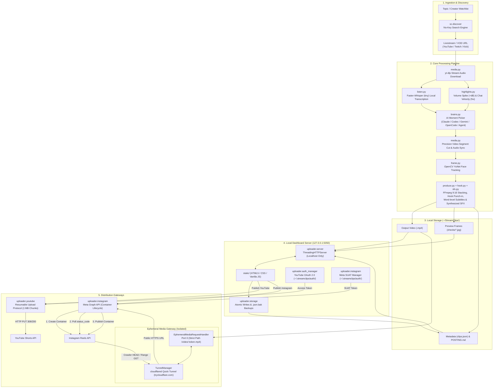
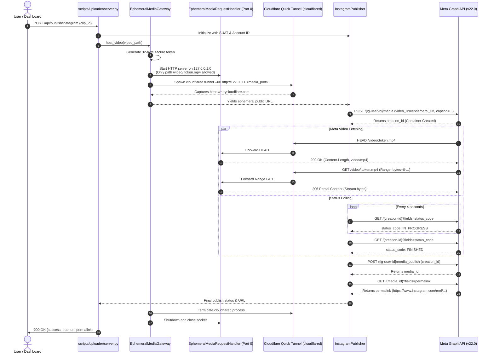

# Stream Clips: Architecture & System Design

This document details the architectural design, component interactions, data flows, and security model of Stream Clips.

---

## 1. High-Level Architecture Overview

Stream Clips consists of three primary subsystems:
1. **The CLI & Core Video Processing Pipeline (`scripts/sc/` and `scripts/streamclips.py`)**: Responsible for stream discovery, audio downloading, Whisper speech-to-text scanning, volume/chat spike detection, AI moment picking, 9:16 vertical re-framing (YuNet face detection), word-by-word subtitle rendering (ASS), audio mastering (-14 LUFS), and synthesized SFX generation.
2. **The Local Dashboard & Metadata Management Hub (`scripts/uploader/` and `scripts/dashboard.py`)**: A local web interface bound exclusively to `127.0.0.1:5050` that discovers generated clips, serves HTML5 video preview with HTTP 206 Partial Content (range requests), allows metadata editing with automatic atomic backups (`clips.json.bak`), and coordinates publishing.
3. **Multi-Platform Publishing & Ephemeral Gateway Subsystem**:
   - **YouTube Data API v3**: Google OAuth 2.0 authorization with token auto-refresh and the official Resumable Video Upload Protocol (chunked HTTP PUT).
   - **Meta Graph API v22.0 (Instagram Reels)**: Long-lived System User Access Token (SUAT) management, an isolated **Ephemeral Media Gateway** over Cloudflare Quick Tunnels (`cloudflared`), and a 3-stage container creation, polling, and publishing lifecycle.

---

## 2. Component Responsibilities

### 2.1 Core Pipeline (`scripts/sc/`)

| Module | Responsibility |
|---|---|
| `cli.py` | Command-line interface parser for `find`, `clip`, `doctor`, and `setup`. |
| `common.py` | Shared utility functions, environment directory resolution, system process execution, thread logging tags, and clock formatting. |
| `discover.py` | Searches YouTube (without API keys via public endpoints) and parses `watchlist.txt` for Twitch, Kick, and YouTube handles. |
| `listen.py` | Manages local speech transcription using `faster-whisper` (`tiny` for scanning, `base` for final subtitles), caching 10-minute blocks. |
| `highlights.py` | Measures RMS volume across the audio timeline and parses chat replays to locate emotional and viral spikes. |
| `brains.py` | Integrates with local AI CLIs (`claude`, `codex`, `gemini`, `opencode`) or falls back to human/agent interaction (`--brain agent`) to pick viral candidates. |
| `media.py` | Handles `yt-dlp` stream downloads and extracts precise video segments, using cross-correlation sound matching to synchronize video to stream audio. |
| `frame.py` | Performs face detection using OpenCV YuNet ONNX model and computes layout geometry: `stack` (facecam over gameplay), `crop` (portrait tracking), or `blur` (landscape over blurred backdrop). |
| `hook.py` | Computes dynamic opening adjustments: removes lead dead air, configures the 0.7-second punch-in zoom, and schedules title-bar drop animation. |
| `sfx.py` | Procedurally synthesizes sound effects (`whoosh`, `impact`, `tick`, `hit`) using `numpy` and `wave`, avoiding external audio assets or copyright issues. |
| `subs.py` | Generates Advanced SubStation Alpha (`.ass`) subtitles with karaoke-style highlight timing and styling. |
| `titlecard.py` | Renders high-resolution title cards using `Pillow`. |
| `produce.py` | Builds complex FFmpeg filtergraphs that combine video scaling, cropping, title animation, subtitle burning, SFX audio ducking, and -14 LUFS loudness normalization. |
| `settings.py` | Dataclass representing user-customizable options, persisted to `~/StreamClips/settings.json`. |

### 2.2 Uploader & Dashboard (`scripts/uploader/`)

| Module | Responsibility |
|---|---|
| `server.py` | Local web server using Python's `ThreadingHTTPServer`, bound strictly to `127.0.0.1`. Serves dashboard assets, REST APIs, and HTTP 206 video streaming. |
| `discovery.py` | Scans configured data directories (`~/StreamClips` or workspace `data/`) for `clips.json` structures without scanning unrelated host files. |
| `storage.py` | Thread-safe, atomic metadata updates (`save_clip_metadata`, `update_clip_upload_status`) with automated `.json.bak` backup creation. |
| `auth_manager.py` | Manages Google OAuth 2.0 authorization code exchange, token persistence, and automatic access token refreshing for YouTube Data API v3. |
| `youtube.py` | Implements Google's official Resumable Video Upload Protocol in 1 MB chunks with resumption support. |
| `instagram.py` | Manages Meta Graph API v22.0 authentication, System User Access Tokens (SUAT), Cloudflare Quick Tunnels, Ephemeral Media Gateway, and container lifecycle. |
| `static/` | Front-end client built with semantic HTML5, modern CSS custom properties, and vanilla ES6+ JavaScript. |

---

## 3. Communication & Data Flow

### 3.1 Dashboard-to-Backend Protocol
- The front-end communicates with the backend exclusively via JSON REST APIs over HTTP at `http://127.0.0.1:5050/api/*`.
- Video playback in the web UI leverages standard HTML5 `<video>` tags utilizing HTTP Range headers (`Range: bytes=start-end`). The server answers with HTTP `206 Partial Content` and `Content-Range: bytes start-end/total`, allowing instant timeline seeking without downloading entire video files.

### 3.2 Metadata Synchronization & Protection
1. Whenever title, caption, or hashtags are updated from the web interface, `uploader.storage` makes a full copy of the current file (`clips.json.bak`).
2. The new state is written to a temporary file (`clips.json.tmp`) and flushed to disk with `os.fsync()`.
3. The temporary file atomically replaces `clips.json` via `os.replace()`.
4. If `POSTING.md` exists in the folder, it is automatically regenerated to reflect the updated metadata.

---

## 4. Publishing Lifecycles

### 4.1 YouTube Shorts Publishing Lifecycle
YouTube video publishing uses the official Google Resumable Upload protocol:
1. **Token Refresh Check**: `AuthManager.get_valid_access_token()` checks the expiration timestamp. If expired, it uses `refresh_token` with `https://oauth2.googleapis.com/token` to obtain a fresh access token.
2. **Session Initiation**: `YouTubeUploader.initiate_resumable_upload()` sends a POST request to `https://www.googleapis.com/upload/youtube/v3/videos?uploadType=resumable` with snippet metadata (title, caption, tags including `#Shorts`, category 20 Gaming). YouTube returns an HTTP `200` with a unique session upload URL in the `Location` response header.
3. **Chunked Streaming**: `YouTubeUploader.upload_chunks()` streams the MP4 file in 1 MB chunks (multiples of 256 KB) via HTTP `PUT`. Each chunk returns HTTP `308 Resume Incomplete` with the `Range` header indicating uploaded progress.
4. **Completion**: Upon uploading the final chunk, YouTube returns HTTP `200 OK` or `201 Created` with video details (`video_id`).
5. **Persistence**: `clips.json` is updated with status `published`, the canonical URL (`https://youtube.com/shorts/<video_id>`), and timestamp.

### 4.2 Instagram Reels Publishing Lifecycle & Ephemeral Gateway
Instagram Reels publishing requires Meta's crawlers to fetch the video file over public HTTPS. Stream Clips solves this locally without cloud hosting costs:

---

## 5. Security & Isolation Architecture

1. **Localhost Binding**: The primary dashboard server binds strictly to `127.0.0.1`. It is inaccessible to other machines on the local network or internet.
2. **Tunnel Port Protection**: `TunnelManager` raises a `ValueError` if `local_port == 5050`, immediately blocking execution. The tunnel **never** points to the dashboard port.
3. **Local Dashboard CSRF & DNS Rebinding Protection**:
   - **Host Header Validation**: All requests (both GET and POST) must supply a local `Host` header (`127.0.0.1`, `localhost`, `::1`) matching the server's listening port; untrusted hostnames or port mismatches (such as those used in DNS rebinding attacks) are rejected with `403 Forbidden`.
   - **Origin & Referer Validation**: State-changing operations (POST requests for publishing, credentials, and metadata) require the `Origin` or `Referer` to match authorized local origins (`http://127.0.0.1:<port>` or `http://localhost:<port>`) on the server's listening port. Untrusted origins, port mismatches, or `null` origins (sandboxed iframes) are rejected with `403 Forbidden`.
   - **Fetch Metadata Validation**: Modern browsers send `Sec-Fetch-Site`. If `Sec-Fetch-Site` is `cross-site`, the request is immediately rejected.
   - **CORS Restriction**: `Access-Control-Allow-Origin` is dynamically restricted strictly to validated local origins.
   - **Limitations**: Origin/Referer validation protects browser users against drive-by cross-site attacks from external websites. It does not protect against malicious native processes already running locally with local network privileges on the same loopback interface.
4. **OAuth State Verification & Anti-Replay**: The `/oauth/youtube/callback` endpoint strictly validates the OAuth `state` parameter against an in-memory cache and immediately invalidates it upon verification, preventing state replay attacks and cross-site authorization hijacking.
5. **Restricted Media Server**: The ephemeral server launched for Meta crawler ingestion accepts only `GET` and `HEAD` on the exact 32-byte randomized path. Any other route or method returns `404 Not Found` or `405 Method Not Allowed`.
6. **Zero Repository Storage for Credentials**: Live credentials, tokens, and client secrets are stored exclusively in `~/.streamclips/auth/` in the user's operating system home directory. They are never written into the project directory or repository tree.
7. **Masking & Log Sanitization**: All tokens displayed in the web UI or logged to stdout/stderr are masked (e.g. `EAAGte...uvwxyz`). Meta and Google error messages pass through `sanitize_error_message()` to ensure raw tokens are never exposed in traceback strings.
